# media-player-music

A Go music player in four programs: **media-player-musicd**, the daemon that
owns the music (the queue, the track playing and where it is, the sound,
the equaliser and ReplayGain, the library, what is kept between runs) and
plays it; and three UIs that show it and drive it, each its own program:
**media-player-music**, the desktop UI with one default layout and
twenty-one optional skins; **media-player-music-tui**, a cmus-like terminal
UI; and **media-player-music-wui**, a web UI (a remote control in a browser).
A track chosen in one shows playing in all of them.

The library holds the music of the folders you choose (your music folder
at the first run), read with every container's tags (ID3, APE, Vorbis
comments, MP4) and watched, so a file added, changed or removed shows at
once; it is browsed by artist, album, genre and year, and searched. M3U,
M3U8, PLS and CUE playlists open in every UI, and the queue saves as M3U8
or PLS.

Audio plays in the daemon, on goframework's audio-playback (MP3, AAC,
FLAC, Ogg Vorbis and Opus, ALAC, Monkey's Audio (APE), WAV, AIFF, AU:
nothing to install), with
ReplayGain (track gain by default, or album, or off; a preamp; the peak keeps
it from clipping; a change is heard at once), read from ID3 (TXXX, RVA2), APE,
Vorbis comments and MP4 tags.
WMA, Musepack and WavPack files do not play. The playlist
shows MP3 and AAC files' ID3 tags as they are added, and the default layout
shows the playing file's front cover. Headless screenshots and
presentation tests retain invented tracks and a synthetic analyser for
repeatable pictures.


Every skin's art is the app's own, drawn in Go by `internal/skins/plans`
(paths, gradients and the app's own pixel faces; the generator reads no
picture). The skins carry neutral IDs; each keeps the layout, controls and
behaviour of the presentation it wears. The menus, the skin lists and the
accessible names show each skin under the label it had before the redraw
(the owner, 2026-11-13): slate is listed as "WinAmp - classic", pod as
"Win Media Player - Xbox", aluminium as "Mac OS X - iTunes", and so on (the
table in docs/faces.md). The captions below use the IDs.

| Slate | Silver | Dossier |
| --- | --- | --- |
| 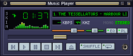 | 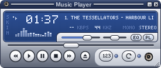 | 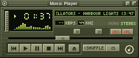 |
| Text Mode | Bevel | Amber |
| 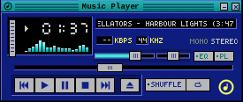 | 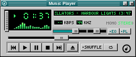 | 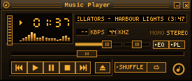 |
| Tally | Head Unit | Graphing |
| 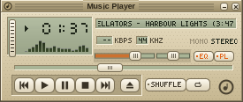 | 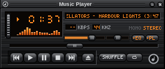 | 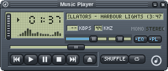 |
| Radar | Forge | |
| 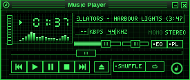 | 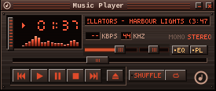 | |

**Default** opens one ordinary, resizable 920 × 560 window. Playback and the
equaliser sit on the left; the playlist sits on the right. Buttons,
shortcuts and context menus provide its actions without a menu bar.

**The compact panel skins** (Slate, Silver, Dossier, Text Mode, Bevel, Amber,
Tally, Head Unit, Graphing, Radar, Forge) use three compact windows: a
playback strip, an equaliser and a resizable playlist that snap together
where the desktop permits positioning. Slate is slate-blue chrome with gold
grooves; Silver rounded silver chrome with a blue dot-matrix display;
Dossier olive field-case chrome; Text Mode a blue character-cell screen;
Bevel light grey bevels with a teal caption; Amber a dark terminal in amber
phosphor; Tally a beige desk adding machine; Head Unit a black dashboard
stereo; Graphing a slate school calculator; Radar a green phosphor scope;
Forge dark iron with a red glow.

**Wingspan** is one shaped window: a jade console with a display, a brow of
transport keys and two speaker wings that fold out for the equaliser (left)
and the playlist (right). Its surroundings are transparent.

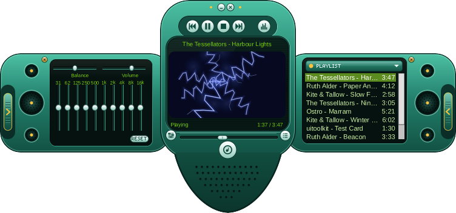

The play key toggles pause during playback. The visualization key switches
between lightning and spectrum bars; both use the app's audio levels. The
lower mark opens appearances and Settings. The playlist heading opens file
and queue actions; **reset** opens EQ presets, On/Auto, preamp and reset.
Ctrl+O and file/folder drops work as in the other appearances.

**Pod** is a shaped gunmetal capsule with a gridded screen, curved seek and
volume tracks, and an equalizer inside the screen. Its separate playlist is
resizable and stays out of the taskbar on desktops supporting utility
windows.

| Pod | Pod playlist |
| --- | --- |
| 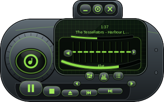 | 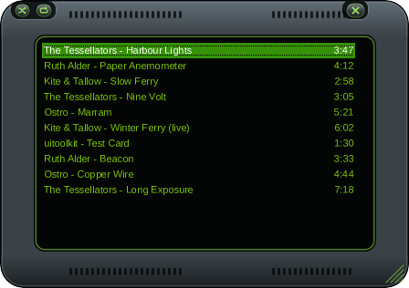 |

The transport shelf provides Play/Pause, Stop, Open, Previous and Next. The
small EQ, effects and playlist keys switch the display or show the playlist.
The round mark and the top key open appearances and Settings. In EQ mode,
the preset name opens On/Auto, preamp, balance, presets and reset; the
arrows cycle presets. Right-clicking the playlist provides file/queue
actions; rows play on double-click.

**Gauge** is a round gunmetal dial with copper trim and curved seek and
volume arcs, with separate equalizer and resizable playlist windows that
snap together and retain their placement. The small shutter key cycles
through the open dial, an iris and a closed visor; covered controls leave
keyboard focus on the shutter key so it can reopen them.

| Gauge | Equalizer | Playlist |
| --- | --- | --- |
| 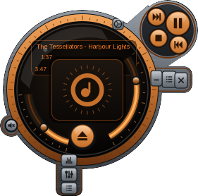 | 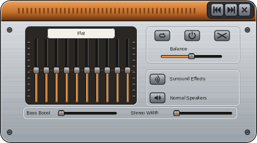 | 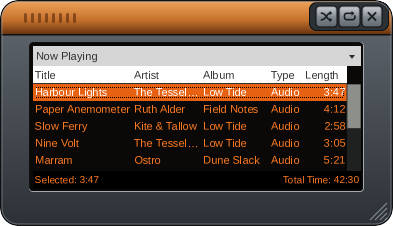 |

The equalizer supports ten bands, balance and presets; its preset name opens
On/Auto, preamp and reset. The surround, bass and width controls stay
disabled because the player does not provide those effects.

**Fandom** is a silver tablet with an embedded settings wing, green
spectrum, inset equalizer and a separate resizable playlist, in the
project's own generated artwork.


**Aluminium** is brushed aluminium: a resizable main window with a
searchable, sortable music library, playback controls and a floating
equalizer. Double-click a song or press Enter to play; file and folder drops
append to the shared queue. Its zoom key or **Ctrl+Shift+M** switches the
same window to a mini player (each mode remembers its size); **Ctrl+F**
returns to the library and focuses search.

| Aluminium | Equalizer |
| --- | --- |
| 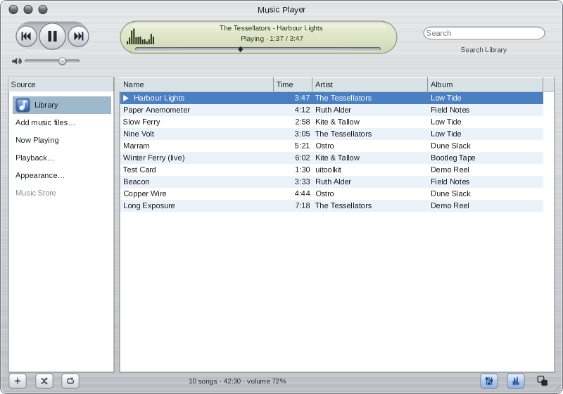 | 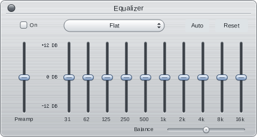 |

**Cobalt** is deep cobalt and pale steel: a resizable main window with the
visualizer, playback controls and sliding playlist and equalizer drawers.
The round toolbar keys open files, toggle the playlist, switch the
visualizer and toggle the equalizer; rewind and fast-forward seek ten
seconds. The bottom full/compact key or **Ctrl+Shift+M** switches the same
window to a fixed-size compact player.

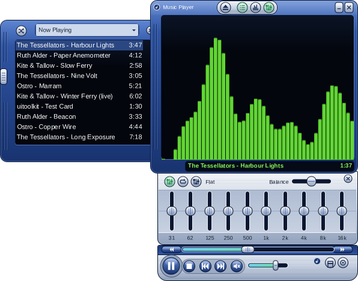

Three plain desktop appearances, each one resizable window:

- **Utility**: a grey window with a toolbar of flat pixel icons, an
  embedded equalizer and the playlist below.
- **Console**: a warm grey console with a slate caption, the playlist and
  equalizer side by side, and a status strip.
- **Sidebar**: a light window with a tabbed sidebar (current track, cover,
  equalizer), a toolbar of line icons and a searchable multi-column playlist.

| Utility | Console | Sidebar |
| --- | --- | --- |
| 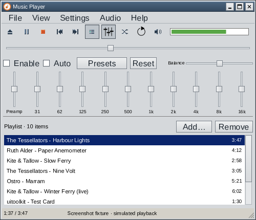 | 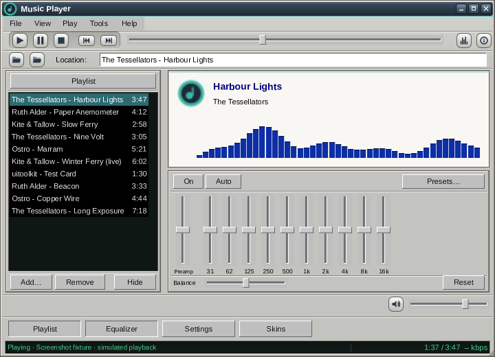 | 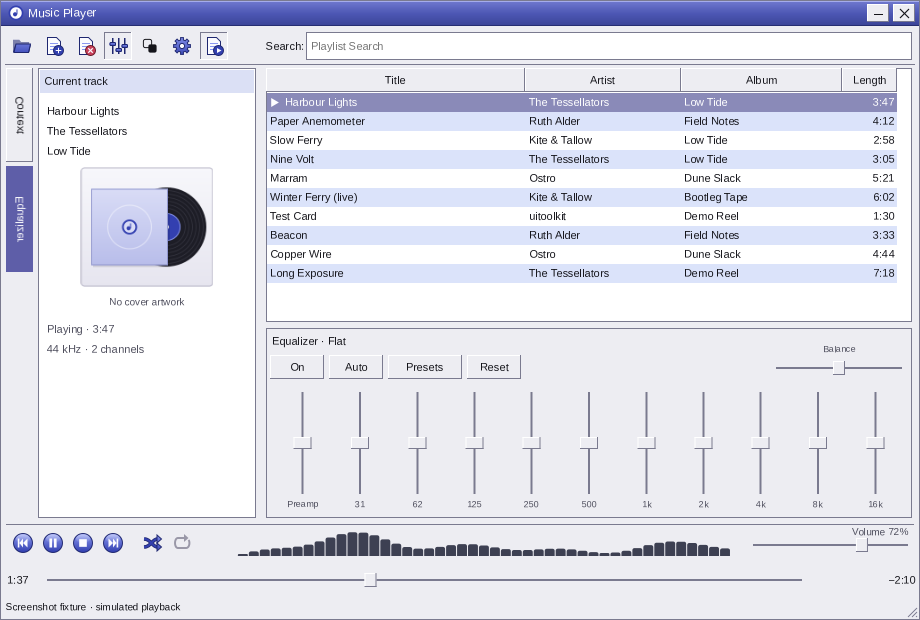 |

**Fancy** is three shaped windows: a 420 × 220 main player, a separate
equalizer and a resizable playlist. Ctrl+Shift+M switches the main window
between the full player and its 420 × 40 compact mode while playback
continues.


The plain desktop appearances use the shared playback engine, queue, file
and folder drops, double-click/Enter playback and close-to-tray behavior.

The app defines its model, windows, controls, actions, layouts, and all skin
packs, including their artwork inputs and generators. goframework.io's desktop-ui (built from a local
workspace until its v0.0.4 release; see [setup](#building-against-goframeworkio))
provides the widgets, skin interpretation, rendering, input, focus,
accessibility, and platform windows through its public API. The
[architecture documentation](docs/faces.md) explains that boundary and the
remaining toolkit integration gaps. What the player still needs from the
framework is in goframework's one ledger, `app-requests.md` in the workspace
(this app's rows are R21, R33 and R34).

## Build and run

Playback needs nothing installed: the daemon decodes in its own process
(goframework's audio-playback) and plays through the system's sound. Each
UI starts the daemon when it does not answer at its default address
(goframework's ensure: the user's service when it is installed as one,
else media-player-musicd next to the UI's program or on PATH, its output
in the music's log folder, media-player-musicd.log), saying "Starting
media-player-musicd…" meanwhile; when it cannot be started the UI says why,
with Retry (the desktop UI in a small window over the player, the
terminal UI under its views with Ctrl+R, the web UI's page beside its
status). A UI given `-daemon` dials that address and starts nothing.

```bash
go build -o . ./cmd/... .
./media-player-musicd &                      # the daemon: the user's socket and ws://127.0.0.1:50130/clients
./media-player-music-tui                     # the terminal UI
./media-player-music-wui                     # the web UI: prints a link good once, for ten minutes
./media-player-music-wui open                # or opens a new one in the browser
./media-player-music                         # the desktop UI: the daemon's queue and place
./media-player-music song.mp3 album.flac      # queue files and play the first
./media-player-music -skin default           # ordinary interface
./media-player-music -skin slate             # compact panel windows (also silver, dossier, textmode,
                                             # bevel, amber, tally, headunit, graphing, radar, forge)
./media-player-music -skin wingspan          # one shaped window with speaker wings
./media-player-music -skin pod               # shaped capsule and a separate playlist
./media-player-music -skin gauge             # round dial, equalizer and playlist windows
./media-player-music -skin fandom            # silver tablet and a separate playlist
./media-player-music -skin aluminium         # library window, with a mini player
./media-player-music -skin cobalt            # drawers and a compact player
./media-player-music -skin utility           # plain grey window (also console, sidebar)
./media-player-music -skin fancy             # blue shaped panels and compact player
./media-player-music -scale 1.75              # fractional display scale
./media-player-music -skin default -shot /tmp/player-shots -at 1m37s
```

The command accepts `./media-player-music [flags] file1.mp3 album.cue`.
With files (or playlists, or folders) it gives the daemon a new queue and
plays its first track; without, it shows the daemon's queue and place
(after a restart of the daemon, stopped until Play). Use Ctrl+O, Eject,
or Playlist → Add to choose music or a playlist, or drag files and
folders from a file manager onto the playlist; Ctrl+S saves the queue as
a playlist. The options are `-skin`, `-scale`, `-shot`, `-at`, `-daemon`
(another daemon's address: `unix://…` or `ws://…`) and `-token` (its
WebSocket's token). A screenshot run uses headless rendering and
synthetic fixtures, writes a posed PNG for each open window, needs no
daemon and plays nothing. `-at` is a Go duration and defaults to 97
seconds.

The daemon keeps the queue, the track and its place, the volume, the
equaliser and ReplayGain in `session.json`, and the library in
`library.index`, in its state folder (`$XDG_STATE_HOME/media-player-music`
on Linux and the BSDs); `media-player-musicd.json` in its config folder
configures it (`listen`, `tokens`, `wui`), the environment's
`MEDIA_PLAYER_MUSICD_*` overriding that. Only the user's own programs come
in: through the socket in the user's runtime folder, and over the
WebSocket with the token in `media-player-musicd.token` beside it. The
web UI's page is the person's who opens its launch link (good once, for
ten minutes, exchanged for a session); it reaches the daemon with that
token, never the browser's cookie.

The app embeds [logo.png](logo.png) for its window, taskbar and system-tray
icons; the skins carry their own mark. Every
main window is titled **Music Player**. Closing the main window hides the
player to the tray and leaves music playing. Clicking the tray icon or
choosing **Show player** restores the main
window and its previously visible panels. **Quit**, Ctrl+Q and Escape exit the
player. If no tray host is showing the icon, closing the main window exits;
if the tray host disappears while hidden, the player returns to the desktop.

The panelled skins (the compact panel skins, Fancy, Fandom and Gauge) keep
their panels together through desktop-ui-rack's `Group`, on whatever
backend the toolkit chooses. Where a program may place its windows (X11,
Windows, macOS) each panel is a window of its own that snaps to the others
and travels with them; on Wayland, which lets no program place a window,
the panels stuck together share one shaped window, and a panel dragged
away by its caption leaves in a window of its own (where the compositor
carries windows, KWin 6 and Mutter 47) to be docked back by a drop.
`GOFRAMEWORK_DESKTOP_UI_BACKEND` choices are honored and screenshots
remain headless.

The skinned equaliser and playlist have no minimize buttons. They declare
owned utility windows through the toolkit; on X11 they have no taskbar or
pager entries. The app refreshes ownership through the public API if Main's
native window is recreated. Native Wayland exposes ownership but no explicit
taskbar policy. These limits are documented in the
uitoolkit gap report's item 12 (in this repository's history: `uitoolkit-gaps.md`,
and `goframework-gaps.md` as of 1da0430).

The desktop UI remembers its skin, panel visibility and window placement in
`$XDG_CONFIG_HOME/goframework-desktop-ui/media-player-music.json`. Default keeps its own
size and position; the compact panel skins share panel positions, playlist size and
snap relationships. Wingspan keeps its own position and fixed 760 × 394
layout. Pod keeps its own main and playlist positions and playlist size.
Gauge separately remembers its three window positions, panel visibility,
playlist size and snap relationships. Fandom keeps separate main/playlist
positions, playlist size and snap relationships; its EQ is in the main display.
Aluminium remembers its full and mini player sizes and library visibility.
Cobalt keeps its own position, full base size and full/compact mode; its
playlist and equalizer drawers share the main window.
Utility, Console and Sidebar each remember their own window size and
position, with shared playlist/equalizer visibility.
Positions restore where the desktop supports them. Missing
files are skipped when the daemon restores the queue. Without saved
settings the app opens in Default. Screenshot runs neither restore nor
save the live session.

Every build includes all of desktop-ui's era theme engines (imported in
[internal/players/toolkit.go](internal/players/toolkit.go)) and font
fallback, which lets native-font song/artist labels borrow missing glyphs
for CJK and other supported scripts from installed fonts.
A covering font must be installed;
`GOFRAMEWORK_DESKTOP_UI_SYSTEM_FONTS=0` disables that lookup. The panel skins' bitmap title
alphabet has its own character limits. The plain build does not shape
or reorder complex scripts. The player's own optional `font_emoji` tag adds
desktop-ui-text-complex: complex-script shaping and colour emoji with
installed covering fonts (`font_complex` shapes without colour emoji):

```bash
go build -tags font_emoji .
```

### Building against goframework.io

The player builds against the local goframework workspace at
`~/go/src/goframework.io`, wired by a `go.work` alone: go.mod names no
goframework module and has no `replace` block. Write the go.work (it names
this machine's folders, so it is not committed), and write it again
whenever the workspace gains a module:

```bash
python3 ~/go/src/goframework.io/tools/app-workspace.py .
GOPROXY=off go build ./...
```

Build with `GOPROXY=off` so a module missing from the workspace fails
instead of being fetched as an old published copy. A release of the player
is built against a published goframework release instead: `app-workspace.py
--remove`, then require that version, and build with `GOWORK=off`.

The app embeds all twenty-one skin packs in every build. To regenerate their
manifests and artwork from the app's Go design sources:

```bash
go generate ./internal/skins
```

## Controls

Open the **Library** from any look's menu ("Library…") or with **Ctrl+B**:
a window of the default look listing the daemon's library by artist (an
artist's albums beside it, and all its tracks), by album, genre or year,
or what a search finds (words and "phrases"; `artist:`, `album:`,
`genre:`, `title:`, `year:`). **Play** plays the tracks listed in place of
the queue (from the track chosen), **Add to queue** adds the track chosen,
or the tracks listed, at the queue's end. All of it by keys: Ctrl+1 to
Ctrl+4 artists, albums, genres, years; Ctrl+F or / the search; in the
lists the arrows, Page Up/Down, Home/End and a name's first letters
choose, Enter goes on to the next list or plays a track, Insert adds to
the queue; Tab moves between the search, the lists and the buttons;
Escape clears the search, then closes the window. The library's folders
are set in the terminal or web UI's settings.

Open **Settings** from Default's gear button, a player context menu,
or **Ctrl+,**. It says which formats play and sets ReplayGain:

- **Off**, **Track gain** or **Album gain**. A track's gain is read from its
  tags: ID3v2's TXXX `REPLAYGAIN_*` frames and RVA2, APEv2 tags (as
  mp3gain writes them), Vorbis comments (FLAC, Ogg) and MP4's freeform
  items. A track without the chosen gain takes the other one; a track
  with neither plays as it is.
- **Preamp**, from -15 to +15 dB, added to the tags' gain.
- The tags' peak keeps the gain from clipping; past it, audio-playback's
  limiter holds the samples at full scale.

A change is heard from the next track. Escape closes Settings.

Files the player does not play (WMA, APE, Musepack, WavPack, AC-3, DTS,
TTA, DSD...) are refused with a message naming their format; a dropped
or opened folder leaves them out and says how many it left. A file whose
format turns out not to play stops with the same kind of message.

All appearances use the shared playback commands; their controls and placement
vary with the presentation. Default and the compact panel skins provide:

- Playback: Previous, Play, Pause, Stop, Next and Eject; seek, volume,
  balance, shuffle, repeat, Equaliser, Playlist and Skin controls.
- Equaliser: On, Auto, Presets, a preamp fader and ten frequency-band faders.
- Playlist: Add, Remove, Select, Miscellaneous and List options, plus a
  second set of six transport controls.

Eject and Open files choose a new playlist. Add appends chosen files; Remove
removes the current track. Playlist drops append files, leaving the originals
in place. Dropped folders add recognized audio files and media containers
(including MP4, M4V, WebM and MKV) recursively in a
deterministic sorted order; scanning runs in the background. Playback takes
the audio of a video file without opening its video.
Adding to an empty queue starts its first track;
adding to an existing queue preserves current playback.

Play starts or resumes playback, Pause toggles
pause/resume, and Stop returns to the start of the track. Seeking and volume
control real playback. A single playlist click selects a row; double-click
or Enter plays it. Arrow-key navigation and selection leave current playback
running. Balance and the ten-band/preamp equaliser are audio-playback's.
Auto chooses an equaliser preset for each track.
The visualizer in every interface shows 48 frequency bands measured from
the playing audio after balance and equaliser processing. Bars
decay when playback pauses or stops; screenshot mode retains its synthetic
fixture.

Switching skins preserves the track, position, queue, volume, balance,
shuffle, repeat and equaliser state. Default and the optional skins share
one model and one clock.

Where the desktop permits positioning, movement events make the main strip
carry its snapped equaliser and playlist as the desktop reports its position. Dragging a satellite away unsnaps it;
bringing it back to an edge rejoins the group. This also works while
playback is paused or stopped. The toolkit preserves the links and stationary
placement of another group when Main rejoins it, and follows a burst of moves
once on the next loop turn. The toolkit now handles the original refused
re-show, closing-satellite and staggered-deadline cases, including direct
requests. The app's pending-geometry flag and pulse are removed. Startup,
saved placement, resizing, captures and backends without movement events
retain their explicit follow behavior.

```text
Space         play / pause     Z / B          previous / next
V             stop             M              mute
Left / Right  seek             Up / Down      volume
S             shuffle          R              repeat: off → all → one
Ctrl+O        open music files or a playlist    Ctrl+S    save the queue as a playlist
Ctrl+,        settings (ReplayGain)    Ctrl+B    the library
Ctrl+K        cycle Default and all optional skins
Ctrl+Shift+K  toggle Default / last optional skin
Ctrl+E        show/hide equaliser    Ctrl+L    show/hide playlist
Shift+F10     skin menu         Escape / Ctrl+Q  quit
```

Focused controls also handle their own navigation keys. Skin choices are
available from the Skin control and context menus. Each skin is listed by its
own name. Scroll with the wheel
or arrow keys to reach the full list in compact windows.
The [skin catalogue](docs/faces.md#one-default-layout-twenty-one-skins) lists all
command-line IDs.

## Tests

`e2e` runs media-player-musicd as a program in folders of its own, its sound
in memory (goframework's audiotest: nothing is heard), and drives it as
two renderers at once, one on its socket and one on its WebSocket with
its token: a queue played to its end, the levels and the equaliser seen by
the other, the library read, browsed and searched, everything kept across a
restart, a WebSocket without the token refused. `internal/service` tests
the daemon's player on a fake engine (loads, seeks, the end of a track, an
engine's error, the queue's edits, playlists and CUE sheets, what is kept);
`internal/library` the library (tags of every container, browsing, search
without case or accents, the index kept and only changed files read again,
folders watched); `internal/playlist` the playlists (and a fuzz test of
their readers); the TUI's and the WUI's packages their own.

The UI tests open headless windows. Run them isolated from the desktop:

```bash
tools/testenv.sh go test ./...
tools/testenv.sh go test -race ./...
tools/testenv.sh go test -tags font_complex ./...
tools/testenv.sh go test -tags font_emoji ./...
```

The helper supplies a private D-Bus session and XDG directories with no
Wayland or X11 display. The suite checks the shared model, skin layouts and
artwork, playlist resizing, keyboard controls, accessibility, and state preservation across
skin changes. Headless URI-drop routing and session restoration tests cover empty
playlists, file/folder loading, fractional-scale placement and dock state.
Presentation tests use synthetic fixtures and playback hooks
and play nothing. The engine's tests play into goframework's audiotest
sound system in memory (no device): MP3 and AAC to their end, seeks, loads
at a position, ID3 metadata, ReplayGain from tags the tests write (ID3
TXXX and RVA2, APEv2, FLAC's Vorbis comments) in every mode, with a
preamp and with the peak holding the gain, and the message for a format
that does not play. The shell's tests drive a fake engine, and one plays
a queue through the shell with the real engine on audiotest. Settings
tests cover the ReplayGain controls, persistence and fractional-scale
layout.
See [docs/faces.md](docs/faces.md) for verification details and
known toolkit limitations.

An optional external XDND test creates its own native X11 windows and
checks folder drops through real selection messages with a fake playback
engine. With an X11 display and `cc`/X11 development headers:

```bash
tools/testenv.sh env DISPLAY=:0 MUSIC_PLAYER_NATIVE_XDND_TEST=1 go test ./internal/shell -run '^TestNativeXDNDPlaylistFolderDrop$' -count=1
```

Use your display value in place of `:0`. Set
`MUSIC_PLAYER_NATIVE_DROP_FOLDER` to test an existing folder without playing
its audio; otherwise the test makes temporary media fixtures. The desktop
must be unlocked: the test skips when its windows are not viewable. It
checks native target discovery before sending the selection messages.

For a file-manager drop that still fails, enable native transfer and app
loader diagnostics while reproducing it on an unlocked desktop:

```bash
GOFRAMEWORK_DESKTOP_UI_XDND_DEBUG=1 MUSIC_PLAYER_DROP_DEBUG=1 ./media-player-music -skin slate
```

The trace on stderr records incoming drag positions and action negotiation,
then decoded paths, background scanning and playlist additions. A position
without an app delivery still needs investigation of target selection or
the native data transfer. Normal runs leave this logging disabled.

## Licence

The Free License — see [LICENSE](LICENSE).

Every skin's artwork is the app's own, drawn in Go (internal/skins/plans).
The originals the earlier skins were cut from stay in internal/skins/sources,
built into nothing, until the owner's history rewrite removes them.

### Monkey's Audio

media-player-musicd decodes Monkey's Audio (.ape) files with
goframework.io/codecs-audio-ape, a translation into Go of Monkey's Audio's
SDK decoder, which is under the 3-clause BSD licence. Its notice, as that
licence asks of a program shipped in binary form:

```text
Monkey's Audio License Agreement (3 clause BSD)

Copyright 2000-2026 Matthew T. Ashland. All rights reserved.

Redistribution and use in source and binary forms, with or without modification, are permitted provided that the following conditions are met:

1) Redistributions of source code must retain the above copyright notice, this list of conditions and the following disclaimer.
2) Redistributions in binary form must reproduce the above copyright notice, this list of conditions and the following disclaimer in the documentation and/or other materials provided with the distribution.
3) Neither the name of the copyright holder nor the names of its contributors may be used to endorse or promote products derived from this software without specific prior written permission.

THIS SOFTWARE IS PROVIDED BY THE COPYRIGHT HOLDERS AND CONTRIBUTORS "AS IS" AND ANY EXPRESS OR IMPLIED WARRANTIES, INCLUDING, BUT NOT LIMITED TO, THE IMPLIED WARRANTIES OF MERCHANTABILITY AND FITNESS FOR A PARTICULAR PURPOSE ARE DISCLAIMED. IN NO EVENT SHALL THE REGENTS OR CONTRIBUTORS BE LIABLE FOR ANY DIRECT, INDIRECT, INCIDENTAL, SPECIAL, EXEMPLARY, OR CONSEQUENTIAL DAMAGES (INCLUDING, BUT NOT LIMITED TO, PROCUREMENT OF SUBSTITUTE GOODS OR SERVICES; LOSS OF USE, DATA, OR PROFITS; OR BUSINESS INTERRUPTION) HOWEVER CAUSED AND ON ANY THEORY OF LIABILITY, WHETHER IN CONTRACT, STRICT LIABILITY, OR TORT (INCLUDING NEGLIGENCE OR OTHERWISE) ARISING IN ANY WAY OUT OF THE USE OF THIS SOFTWARE, EVEN IF ADVISED OF THE POSSIBILITY OF SUCH DAMAGE.
```
