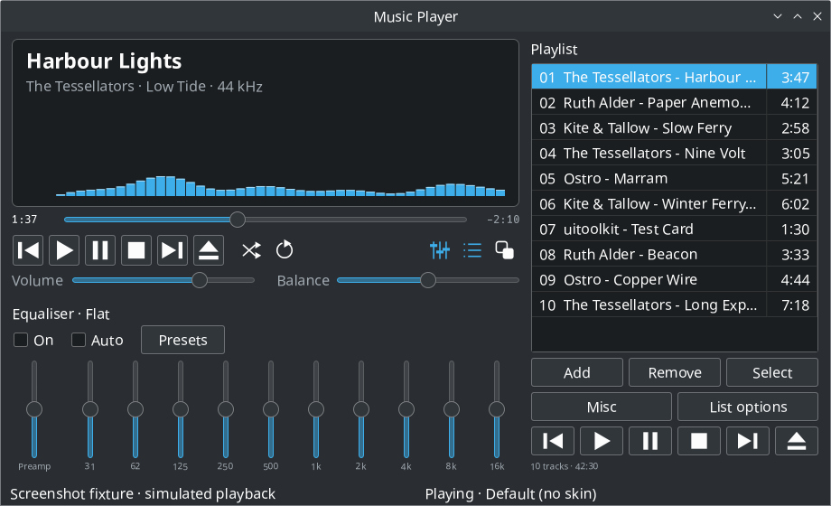
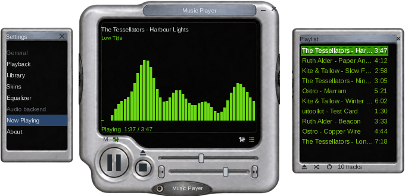
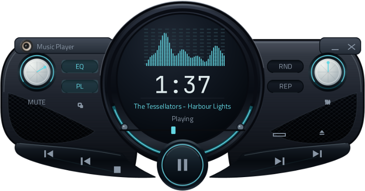

# media-player-music

A Go music player in four programs: **media-player-musicd**, the daemon that
owns the music (the queue, the track playing and where it is, the sound,
the equaliser and ReplayGain, the library, what is kept between runs) and
plays it; and three UIs that show it and drive it, each its own program:
**media-player-music**, the desktop UI with one default layout and
twenty-one optional skins; **media-player-music-tui**, a cmus-like terminal
UI; and **media-player-music-wui**, a web UI (a remote control in a browser).
A track chosen in one shows playing in all of them.

The library holds the music of the folders you choose (your music folder
at the first run), read with every container's tags (ID3, APE, Vorbis
comments, MP4) and watched, so a file added, changed or removed shows at
once; it is browsed by artist, album, genre and year, and searched. M3U,
M3U8, PLS and CUE playlists open in every UI, and the queue saves as M3U8
or PLS.

Audio plays in the daemon, on goframework's audio-playback (MP3, AAC,
FLAC, Ogg Vorbis and Opus, ALAC, Monkey's Audio (APE), WAV, AIFF, AU:
nothing to install), with
ReplayGain (track gain by default, or album, or off; a preamp; the peak keeps
it from clipping; a change is heard at once), read from ID3 (TXXX, RVA2), APE,
Vorbis comments and MP4 tags.
WMA, Musepack and WavPack files do not play. The playlist
shows MP3 and AAC files' ID3 tags as they are added, and the default layout
shows the playing file's front cover. Headless screenshots and
presentation tests retain invented tracks and a synthetic analyser for
repeatable pictures.



| WinAmp - classic | WinAmp - Silver | WinAmp - Classified |
| --- | --- | --- |
|  |  |  |

| WinAmp - DOSamp | WinAmp - Windows 98 |
| --- | --- |
|  |  |
| WinAmp - Classic Amber | WinAmp - Calculator |
|  |  |
| WinAmp - Sony CDX-MP3 | WinAmp - TI-82 |
|  |  |
| WinAmp - Radar Amp | WinAmp - Quake 3 Arena |
|  |  |

**Default** opens one ordinary, resizable 920 × 560 window. Playback and the
equaliser sit on the left; the playlist sits on the right. Buttons,
shortcuts and context menus provide its actions without a menu bar.
**WinAmp - classic** and **WinAmp - Silver** use three compact windows:
a playback strip, an equaliser
and a resizable playlist that snap together where the desktop permits positioning.
**WinAmp - Classified** adapts the artwork from
[Winamp3 Classified v5.5](https://skins.webamp.org/skin/cd251187a5e6ff54ce938d26f1f2de02/Winamp3_Classified_v5.5.wsz/)
to the same three-panel player. Imported skins also include DOSamp, Windows 98,
Winamp Classic Amber, Calculator, Sony CDX-MP3, TI-82, Radar Amp and Quake 3 Arena.
Their original archives and credits are retained in [skin sources](internal/skins/sources/README.md).

**Win Media Player - Headspace** adapts the original Windows Media Player
skin into one shaped window, with its green head, speaker wings, equalizer
and playlist. Its transparent surroundings let the desktop show through.


The purple Play button toggles pause during playback. The yellow visualization
button switches between lightning and spectrum bars; both use the app's audio
levels. The lower-center logo opens appearances and Settings. The playlist
heading opens file and queue actions; **reset** opens EQ presets, On/Auto,
preamp and reset. Ctrl+O and file/folder drops work as in the other appearances.

**Win Media Player - Xbox** uses the original official 2002 Xbox skin by
The Skins Factory: a shaped silver and black main window, green display,
curved seek and volume controls, and an equalizer inside the display.
Its separate playlist is resizable and stays out of the taskbar on desktops
supporting utility windows. The original archive, artwork, credits and
scripts are preserved in [Xbox sources](internal/skins/sources/xbox/README.md).


The silver transport strip provides Play/Pause, Stop, Open, Previous and Next.
The small EQ, effects and playlist buttons switch the display or show the
playlist. The Xbox logo and top full-mode button open appearances and Settings.
In EQ mode, the preset name opens On/Auto, preamp, balance, presets and reset;
the arrows cycle presets. The glow and bars use the app's audio levels.
Right-clicking the playlist provides file/queue actions. File and folder drops work on either
window; playlist rows start playback on double-click.

**Win Media Player - Half Life 2** uses the original Valve/The Skins Factory
skin: an orange circular main window with curved seek and volume controls,
and separate equalizer and resizable playlist windows. The three windows snap
together and retain their placement. The small shutter button cycles through
the open display, inner cover and outer Lambda cover. Covered playback
controls leave keyboard focus on the shutter button so it can reopen them.


The original Play/Pause, Stop, Previous, Next, Open and mute controls drive
the shared playback engine. The lower buttons toggle the visualizer,
equalizer and playlist. The central Lambda logo and small menu button open
appearances and Settings. The equalizer supports ten bands, balance and
presets; its preset name opens On/Auto, preamp and reset. Original SRS WOW,
TruBass and crossfade controls remain disabled because the player does not
provide those effects. The original archive and notices are retained in
[Half Life 2 sources](internal/skins/sources/half-life-2/README.md).
Video, promotional web views, startup animations and skin sound effects
are preserved as source material; the music player uses the three audio views.

**Win Media Player - Fandom** recreates the supplied silver player reference
with an embedded settings wing, green spectrum, inset equalizer and a
separate resizable playlist. Its controls use the same playback engine,
queue and app settings. The original skin name, creator and archive have not
been verified; this is a reference adaptation with artwork generated using
the built-in image tool, rather than an imported original WMP skin.
[Artwork and prompts](internal/skins/sources/fandom/README.md).



**Mac OS X - iTunes** adapts original Apple iTunes 4.0 controls and brushed-metal
chrome from the 2003 Music Store era. Its resizable main window has a searchable,
sortable music library, playback controls and a floating equalizer. Double-click
a song or press Enter to play; file and folder drops append to the shared queue.
The original Music Store service is unavailable in this player.
[Original resources and provenance](internal/skins/sources/itunes/README.md).


The green zoom button or **Ctrl+Shift+M** switches the same main window to
MiniPlayer. Drag its bottom-right grip to show or hide track information;
its height stays fixed. The wide and compact views keep working transport and
volume controls. Each mode remembers its size and keeps the current position.
**Ctrl+F** returns to the library and focuses search. Closing either main view
uses the existing close-to-tray behavior.


**Win Media Player - Series 9** adapts Microsoft's original blue-and-silver
9 Series Default skin. Its resizable main window contains the visualizer,
playback controls and sliding playlist and equalizer drawers. The original
archive, artwork and scripts are retained in
[Series 9 sources](internal/skins/sources/series-9/README.md).


The round toolbar buttons open files, toggle the playlist, switch the
visualizer and toggle the equalizer. The lower controls provide Play/Pause,
Stop, Previous, Next, mute, seek and volume. Rewind and fast-forward seek ten
seconds. The app logo opens Settings; the return button opens appearances.
The playlist heading opens file and queue actions, and its songs play on
double-click or Enter. File and folder drops append to the queue.


The bottom full/compact button or **Ctrl+Shift+M** switches the same native
window to the original fixed-size compact player. Playback continues, and
returning to full mode restores its size and drawer visibility. Closing either
view uses the existing close-to-tray behavior.


Three classic desktop appearances reproduce the older players' layouts and
controls, with original transport artwork where available:

- **VLC - Classic** uses VLC 0.8.6's wxWidgets-era toolbar, gray beveled controls,
  an embedded playlist and equalizer. [Original sources](internal/skins/sources/vlc/README.md).
- **RealPlayer - Classic** uses the RealPlayer 8 gray-and-blue arrangement and
  original Windows control sprites, with the local queue and equalizer inside
  the main window. [Original resources](internal/skins/sources/realplayer/README.md).
- **KDE - Amarok 1.4** uses KDE 3 silver chrome, blue transport buttons,
  current-track context and a searchable playlist table.
  [Original sources](internal/skins/sources/amarok/README.md).

| VLC - Classic | RealPlayer - Classic | KDE - Amarok 1.4 |
| --- | --- | --- |
|  |  |  |

**Fancy** adapts the supplied blue player reference into three shaped windows:
a 420 × 220 main player, a separate equalizer and a resizable playlist.
Ctrl+Shift+M switches the same main window between the full player and its
420 × 40 compact mode while playback continues.
The panels and compact mode use the shared queue, playback and tray behavior.
The app draws the artwork and defines the layout from the supplied reference.




The three classic desktop appearances each have one resizable window and use the shared playback engine,
queue, file and folder drops, double-click/Enter playback and close-to-tray
behavior. The VLC skin is an appearance only: playback is the player's own.
Original network services and
media-library databases are outside these local music views.

The ten bitmap-based skins include separate 2× artwork for sharper control
edges at enlarged display scales. Small bitmap letters, clock digits and
display patterns keep their original pixel rendering. Silver retains its
existing artwork and rendering.

The app defines its model, windows, controls, actions, layouts, and all skin
packs, including their artwork inputs and generators. goframework.io's desktop-ui (built from a local
workspace until its v0.0.4 release; see [setup](#building-against-goframeworkio))
provides the widgets, skin interpretation, rendering, input, focus,
accessibility, and platform windows through its public API. The
[architecture documentation](docs/faces.md) explains that boundary and the
remaining toolkit integration gaps. What the player still needs from the
framework is in goframework's one ledger, `app-requests.md` in the workspace
(this app's rows are R21, R33 and R34).

## Build and run

Playback needs nothing installed: the daemon decodes in its own process
(goframework's audio-playback) and plays through the system's sound. Start
the daemon, then any of the UIs (until goframework's "ensure daemon"
facility lands, a UI does not start the daemon itself: it says it cannot
reach it, and keeps trying):

```bash
go build -o . ./cmd/... .
./media-player-musicd &                      # the daemon: the user's socket and ws://127.0.0.1:50130/clients
./media-player-music-tui                     # the terminal UI
./media-player-music-wui                     # the web UI: prints a link good once, for ten minutes
./media-player-music-wui open                # or opens a new one in the browser
./media-player-music                         # the desktop UI: the daemon's queue and place
./media-player-music song.mp3 album.flac      # queue files and play the first
./media-player-music -skin default           # ordinary interface
./media-player-music -skin winamp            # classic panel windows
./media-player-music -skin winamp-silver      # silver panel windows
./media-player-music -skin winamp-classified  # Classified panel windows
./media-player-music -skin dosamp            # DOSamp
./media-player-music -skin windows-98        # Windows 98
./media-player-music -skin headspace         # Win Media Player - Headspace
./media-player-music -skin xbox              # Win Media Player - Xbox
./media-player-music -skin half-life-2       # Win Media Player - Half Life 2
./media-player-music -skin fandom            # Win Media Player - Fandom
./media-player-music -skin itunes            # Mac OS X - iTunes, with MiniPlayer
./media-player-music -skin series-9          # Win Media Player - Series 9
./media-player-music -skin vlc               # classic VLC 0.8 wxWidgets appearance
./media-player-music -skin realplayer        # classic RealPlayer 8 appearance
./media-player-music -skin amarok            # KDE 3 Amarok 1.4 appearance
./media-player-music -skin fancy             # blue shaped panels and compact player
./media-player-music -scale 1.75              # fractional display scale
./media-player-music -skin default -shot /tmp/player-shots -at 1m37s
```

The command accepts `./media-player-music [flags] file1.mp3 album.cue`.
With files (or playlists, or folders) it gives the daemon a new queue and
plays its first track; without, it shows the daemon's queue and place
(after a restart of the daemon, stopped until Play). Use Ctrl+O, Eject,
or Playlist → Add to choose music or a playlist, or drag files and
folders from a file manager onto the playlist; Ctrl+S saves the queue as
a playlist. The options are `-skin`, `-scale`, `-shot`, `-at`, `-daemon`
(another daemon's address: `unix://…` or `ws://…`) and `-token` (its
WebSocket's token). A screenshot run uses headless rendering and
synthetic fixtures, writes a posed PNG for each open window, needs no
daemon and plays nothing. `-at` is a Go duration and defaults to 97
seconds.

The daemon keeps the queue, the track and its place, the volume, the
equaliser and ReplayGain in `session.json`, and the library in
`library.index`, in its state folder (`$XDG_STATE_HOME/media-player-music`
on Linux and the BSDs); `media-player-musicd.json` in its config folder
configures it (`listen`, `tokens`, `wui`), the environment's
`MEDIA_PLAYER_MUSICD_*` overriding that. Only the user's own programs come
in: through the socket in the user's runtime folder, and over the
WebSocket with the token in `media-player-musicd.token` beside it. The
web UI's page is the person's who opens its launch link (good once, for
ten minutes, exchanged for a session); it reaches the daemon with that
token, never the browser's cookie.

The app embeds [logo.png](logo.png) for its window, taskbar and system-tray
icons and replaces legacy Winamp logos in the adapted skin artwork. Every
main window is titled **Music Player**. Closing the main window hides the
player to the tray and leaves music playing. Clicking the tray icon or
choosing **Show player** restores the main
window and its previously visible panels. **Quit**, Ctrl+Q and Escape exit the
player. If no tray host is showing the icon, closing the main window exits;
if the tray host disappears while hidden, the player returns to the desktop.

The panelled skins (the Winamp skins, Fancy, Fandom and Half Life 2) keep
their panels together through desktop-ui-rack's `Group`, on whatever
backend the toolkit chooses. Where a program may place its windows (X11,
Windows, macOS) each panel is a window of its own that snaps to the others
and travels with them; on Wayland, which lets no program place a window,
the panels stuck together share one shaped window, and a panel dragged
away by its caption leaves in a window of its own (where the compositor
carries windows, KWin 6 and Mutter 47) to be docked back by a drop.
`GOFRAMEWORK_DESKTOP_UI_BACKEND` choices are honored and screenshots
remain headless.

The skinned equaliser and playlist have no minimize buttons. They declare
owned utility windows through the toolkit; on X11 they have no taskbar or
pager entries. The app refreshes ownership through the public API if Main's
native window is recreated. Native Wayland exposes ownership but no explicit
taskbar policy. These limits are documented in the
uitoolkit gap report's item 12 (in this repository's history: `uitoolkit-gaps.md`,
and `goframework-gaps.md` as of 1da0430).

The desktop UI remembers its skin, panel visibility and window placement in
`$XDG_CONFIG_HOME/goframework-desktop-ui/media-player-music.json`. Default keeps its own
size and position; Winamp skins share panel positions, playlist size and
snap relationships. Headspace keeps its own position and fixed 760 × 394
layout. Xbox keeps its own main and playlist positions and playlist size.
Half Life 2 separately remembers its three window positions, panel visibility,
playlist size and snap relationships. Fandom keeps separate main/playlist
positions, playlist size and snap relationships; its EQ is in the main display.
iTunes remembers its full and MiniPlayer sizes and library visibility.
Series 9 keeps its own position, full base size and full/compact mode; its
playlist and equalizer drawers share the main window.
Classic VLC, RealPlayer and Amarok each remember their own window size and
position, with shared playlist/equalizer visibility.
Positions restore where the desktop supports them. Missing
files are skipped when the daemon restores the queue. Without saved
settings the app opens in Default. Screenshot runs neither restore nor
save the live session.

Every build includes all of desktop-ui's era theme engines (imported in
[internal/players/toolkit.go](internal/players/toolkit.go)) and font
fallback, which lets native-font song/artist labels borrow missing glyphs
for CJK and other supported scripts from installed fonts.
A covering font must be installed;
`GOFRAMEWORK_DESKTOP_UI_SYSTEM_FONTS=0` disables that lookup. The original Winamp bitmap title
alphabet retains its source-art character limits. The plain build does not shape
or reorder complex scripts. The player's own optional `font_emoji` tag adds
desktop-ui-text-complex: complex-script shaping and colour emoji with
installed covering fonts (`font_complex` shapes without colour emoji):

```bash
go build -tags font_emoji .
```

### Building against goframework.io

The player builds against the local goframework workspace at
`~/go/src/goframework.io`, wired by a `go.work` alone: go.mod names no
goframework module and has no `replace` block. Write the go.work (it names
this machine's folders, so it is not committed), and write it again
whenever the workspace gains a module:

```bash
python3 ~/go/src/goframework.io/tools/app-workspace.py .
GOPROXY=off go build ./...
```

Build with `GOPROXY=off` so a module missing from the workspace fails
instead of being fetched as an old published copy. A release of the player
is built against a published goframework release instead: `app-workspace.py
--remove`, then require that version, and build with `GOWORK=off`.

The app embeds all twenty-one skin packs in every build. To regenerate their
manifests and artwork from the app's Go design sources:

```bash
go generate ./internal/skins
```

## Controls

Open **Settings** from Default's gear button, a player context menu,
or **Ctrl+,**. It says which formats play and sets ReplayGain:

- **Off**, **Track gain** or **Album gain**. A track's gain is read from its
  tags: ID3v2's TXXX `REPLAYGAIN_*` frames and RVA2, APEv2 tags (as
  mp3gain writes them), Vorbis comments (FLAC, Ogg) and MP4's freeform
  items. A track without the chosen gain takes the other one; a track
  with neither plays as it is.
- **Preamp**, from -15 to +15 dB, added to the tags' gain.
- The tags' peak keeps the gain from clipping; past it, audio-playback's
  limiter holds the samples at full scale.

A change is heard from the next track. Escape closes Settings.

Files the player does not play (WMA, APE, Musepack, WavPack, AC-3, DTS,
TTA, DSD...) are refused with a message naming their format; a dropped
or opened folder leaves them out and says how many it left. A file whose
format turns out not to play stops with the same kind of message.

All appearances use the shared playback commands; their controls and placement
vary with the original design. Default and the Winamp skins provide:

- Playback: Previous, Play, Pause, Stop, Next and Eject; seek, volume,
  balance, shuffle, repeat, Equaliser, Playlist and Skin controls.
- Equaliser: On, Auto, Presets, a preamp fader and ten frequency-band faders.
- Playlist: Add, Remove, Select, Miscellaneous and List options, plus a
  second set of six transport controls.

Eject and Open files choose a new playlist. Add appends chosen files; Remove
removes the current track. Playlist drops append files, leaving the originals
in place. Dropped folders add recognized audio files and media containers
(including MP4, M4V, WebM and MKV) recursively in a
deterministic sorted order; scanning runs in the background. Playback takes
the audio of a video file without opening its video.
Adding to an empty queue starts its first track;
adding to an existing queue preserves current playback.

Play starts or resumes playback, Pause toggles
pause/resume, and Stop returns to the start of the track. Seeking and volume
control real playback. A single playlist click selects a row; double-click
or Enter plays it. Arrow-key navigation and selection leave current playback
running. Balance and the ten-band/preamp equaliser are audio-playback's.
Auto chooses an equaliser preset for each track.
The visualizer in every interface shows 48 frequency bands measured from
the playing audio after balance and equaliser processing. Bars
decay when playback pauses or stops; screenshot mode retains its synthetic
fixture.

Switching skins preserves the track, position, queue, volume, balance,
shuffle, repeat and equaliser state. Default and the optional skins share
one model and one clock.

Where the desktop permits positioning, movement events make the main strip
carry its snapped equaliser and playlist as the desktop reports its position. Dragging a satellite away unsnaps it;
bringing it back to an edge rejoins the group. This also works while
playback is paused or stopped. The toolkit preserves the links and stationary
placement of another group when Main rejoins it, and follows a burst of moves
once on the next loop turn. The toolkit now handles the original refused
re-show, closing-satellite and staggered-deadline cases, including direct
requests. The app's pending-geometry flag and pulse are removed. Startup,
saved placement, resizing, captures and backends without movement events
retain their explicit follow behavior.

```text
Space         play / pause     Z / B          previous / next
V             stop             M              mute
Left / Right  seek             Up / Down      volume
S             shuffle          R              repeat: off → all → one
Ctrl+O        open music files or a playlist    Ctrl+S    save the queue as a playlist
Ctrl+,        settings (ReplayGain)
Ctrl+K        cycle Default and all optional skins
Ctrl+Shift+K  toggle Default / last optional skin
Ctrl+E        show/hide equaliser    Ctrl+L    show/hide playlist
Shift+F10     skin menu         Escape / Ctrl+Q  quit
```

Focused controls also handle their own navigation keys. Skin choices are
available from the Skin control and context menus. Default keeps its name;
Winamp choices use **WinAmp -** followed by their skin name, with the
original Winamp listed as **WinAmp - classic**. Scroll with the wheel
or arrow keys to reach the full list in compact windows.
The [skin catalogue](docs/faces.md#one-default-layout-twenty-one-skins) lists all
command-line IDs.

## Tests

`e2e` runs media-player-musicd as a program in folders of its own, its sound
in memory (goframework's audiotest: nothing is heard), and drives it as
two renderers at once, one on its socket and one on its WebSocket with
its token: a queue played to its end, the levels and the equaliser seen by
the other, the library read, browsed and searched, everything kept across a
restart, a WebSocket without the token refused. `internal/service` tests
the daemon's player on a fake engine (loads, seeks, the end of a track, an
engine's error, the queue's edits, playlists and CUE sheets, what is kept);
`internal/library` the library (tags of every container, browsing, search
without case or accents, the index kept and only changed files read again,
folders watched); `internal/playlist` the playlists (and a fuzz test of
their readers); the TUI's and the WUI's packages their own.

The UI tests open headless windows. Run them isolated from the desktop:

```bash
tools/testenv.sh go test ./...
tools/testenv.sh go test -race ./...
tools/testenv.sh go test -tags font_complex ./...
tools/testenv.sh go test -tags font_emoji ./...
```

The helper supplies a private D-Bus session and XDG directories with no
Wayland or X11 display. The suite checks the shared model, skin layouts and
artwork, playlist resizing, keyboard controls, accessibility, and state preservation across
skin changes. Headless URI-drop routing and session restoration tests cover empty
playlists, file/folder loading, fractional-scale placement and dock state.
Presentation tests use synthetic fixtures and playback hooks
and play nothing. The engine's tests play into goframework's audiotest
sound system in memory (no device): MP3 and AAC to their end, seeks, loads
at a position, ID3 metadata, ReplayGain from tags the tests write (ID3
TXXX and RVA2, APEv2, FLAC's Vorbis comments) in every mode, with a
preamp and with the peak holding the gain, and the message for a format
that does not play. The shell's tests drive a fake engine, and one plays
a queue through the shell with the real engine on audiotest. Settings
tests cover the ReplayGain controls, persistence and fractional-scale
layout.
See [docs/faces.md](docs/faces.md) for verification details and
known toolkit limitations.

An optional external XDND test creates its own native X11 windows and
checks folder drops through real selection messages with a fake playback
engine. With an X11 display and `cc`/X11 development headers:

```bash
tools/testenv.sh env DISPLAY=:0 MUSIC_PLAYER_NATIVE_XDND_TEST=1 go test ./internal/shell -run '^TestNativeXDNDPlaylistFolderDrop$' -count=1
```

Use your display value in place of `:0`. Set
`MUSIC_PLAYER_NATIVE_DROP_FOLDER` to test an existing folder without playing
its audio; otherwise the test makes temporary media fixtures. The desktop
must be unlocked: the test skips when its windows are not viewable. It
checks native target discovery before sending the selection messages.

For a file-manager drop that still fails, enable native transfer and app
loader diagnostics while reproducing it on an unlocked desktop:

```bash
GOFRAMEWORK_DESKTOP_UI_XDND_DEBUG=1 MUSIC_PLAYER_DROP_DEBUG=1 ./media-player-music -skin winamp
```

The trace on stderr records incoming drag positions and action negotiation,
then decoded paths, background scanning and playlist additions. A position
without an app delivery still needs investigation of target selection or
the native data transfer. Normal runs leave this logging disabled.

## Licence

The Free License — see [LICENSE](LICENSE).

Imported artwork retains its original authors' copyright and notices;
see each skin's [source and credits](internal/skins/sources/README.md).

### Monkey's Audio

media-player-musicd decodes Monkey's Audio (.ape) files with
goframework.io/codecs-audio-ape, a translation into Go of Monkey's Audio's
SDK decoder, which is under the 3-clause BSD licence. Its notice, as that
licence asks of a program shipped in binary form:

```text
Monkey's Audio License Agreement (3 clause BSD)

Copyright 2000-2026 Matthew T. Ashland. All rights reserved.

Redistribution and use in source and binary forms, with or without modification, are permitted provided that the following conditions are met:

1) Redistributions of source code must retain the above copyright notice, this list of conditions and the following disclaimer.
2) Redistributions in binary form must reproduce the above copyright notice, this list of conditions and the following disclaimer in the documentation and/or other materials provided with the distribution.
3) Neither the name of the copyright holder nor the names of its contributors may be used to endorse or promote products derived from this software without specific prior written permission.

THIS SOFTWARE IS PROVIDED BY THE COPYRIGHT HOLDERS AND CONTRIBUTORS "AS IS" AND ANY EXPRESS OR IMPLIED WARRANTIES, INCLUDING, BUT NOT LIMITED TO, THE IMPLIED WARRANTIES OF MERCHANTABILITY AND FITNESS FOR A PARTICULAR PURPOSE ARE DISCLAIMED. IN NO EVENT SHALL THE REGENTS OR CONTRIBUTORS BE LIABLE FOR ANY DIRECT, INDIRECT, INCIDENTAL, SPECIAL, EXEMPLARY, OR CONSEQUENTIAL DAMAGES (INCLUDING, BUT NOT LIMITED TO, PROCUREMENT OF SUBSTITUTE GOODS OR SERVICES; LOSS OF USE, DATA, OR PROFITS; OR BUSINESS INTERRUPTION) HOWEVER CAUSED AND ON ANY THEORY OF LIABILITY, WHETHER IN CONTRACT, STRICT LIABILITY, OR TORT (INCLUDING NEGLIGENCE OR OTHERWISE) ARISING IN ANY WAY OUT OF THE USE OF THIS SOFTWARE, EVEN IF ADVISED OF THE POSSIBILITY OF SUCH DAMAGE.
```
